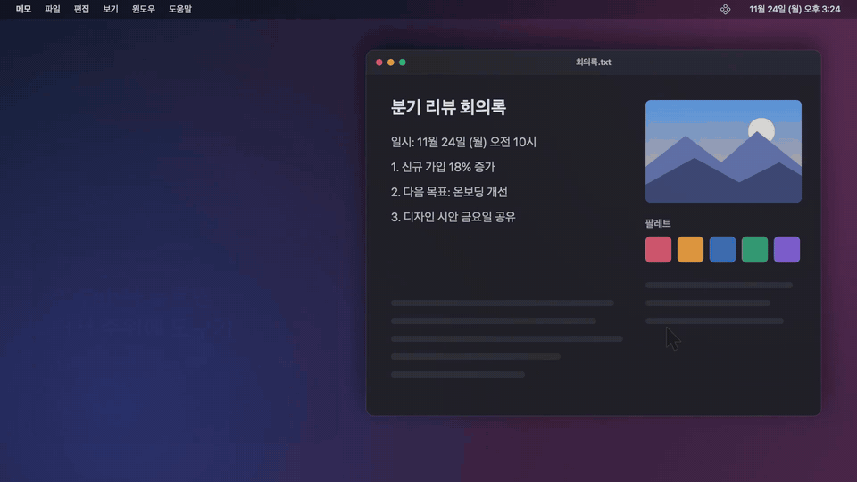

# MacB

단축키 하나로 여는 **원형 메뉴**. 스크린샷, 글자 인식, 색상 추출, 클립보드 기록 같은 도구를 커서 위치에서 바로 꺼내 쓴다. 메뉴 막대에 상주하는 네이티브 macOS 앱(Swift/AppKit)이다.



▶ [소개 영상 보기 (43초)](docs/media/macb-promo.mp4)

## 설치

macOS 14 이상, Apple 실리콘·Intel 맥 모두 된다.

1. [GitHub Releases](../../releases/latest)에서 `MacB-<버전>.dmg`를 받아 연다.
2. 창에 보이는 **MacB**를 **Applications** 폴더로 끌어다 놓는다.
3. 처음 한 번은 **응용 프로그램** 폴더에서 MacB를 우클릭 › **열기**로 실행한다.
   Apple 공증을 받지 않은 앱이라 그냥 더블클릭하면 "확인되지 않은 개발자" 경고가 뜨고 열리지 않는다.
   이미 막혔다면 **시스템 설정 › 개인정보 보호 및 보안** 아래쪽의 **그래도 열기**를 누르거나 터미널에서 격리 표시를 지운다.

   ```bash
   xattr -dr com.apple.quarantine /Applications/MacB.app
   ```

실행되면 메뉴 막대에 ⊕ 모양 아이콘이 생기고 권한 안내 창이 뜬다([권한](#권한) 참고).
받은 파일이 맞는지 확인하려면 같은 릴리스의 `.sha256` 파일과 `shasum -a 256 MacB-<버전>.dmg` 결과를 비교한다.

## 소스에서 빌드

Xcode 없이 Command Line Tools만 있으면 된다.

```bash
Scripts/build-app.sh --run        # build/MacB.app 을 만들고 실행
Scripts/build-app.sh --install    # /Applications 에 설치
```

실행하면 메뉴 막대에 ⊕ 모양 아이콘이 생긴다. Dock 아이콘은 없다.

계속 쓸 거라면 `--install`로 `/Applications`에 넣고 거기서 실행한다. `build/MacB.app`은 빌드할 때마다 새로 만들어지므로
메뉴 막대의 **로그인할 때 자동 실행**은 `/Applications`에 설치한 앱에서 켜야 유지된다.
켰는데 macOS가 허용을 요구하면 **시스템 설정 › 일반 › 로그인 항목**이 열리니 거기서 MacB를 켠다.

## 사용법

### 원형 메뉴 — `⌥Tab`

| 방식 | 조작 |
| --- | --- |
| **누른 채 긋기** | `⌥Tab`을 누르고 있는 동안 메뉴가 뜬다. 커서를 항목 쪽으로 밀고 키를 떼면 실행. 가운데에 둔 채 떼거나 `esc`를 누르면 취소. |
| **열어 두기** | `⌥Tab`을 짧게 톡 누르면 열린 채로 남는다. 클릭, 숫자키 `1`–`8`, 화살표 + `Return`으로 고르고 `esc`·바깥 클릭·`⌥Tab`으로 닫는다. |

누른 채 긋기는 방향만 본다. 커서가 원 밖으로 멀리 나가도 그 방향의 항목이 선택되므로 익숙해지면 보지 않고 휙 그을 수 있다.

기본 항목(12시 방향부터 시계 방향):

| 항목 | 하는 일 |
| --- | --- |
| 영역 캡처 | 드래그한 영역을 클립보드로 |
| 창 캡처 | 창 하나를 클립보드로 |
| 클립보드 | 복사 기록 패널 열기 |
| 색상 추출 | 화면에서 찍은 색의 `#RRGGBB`를 복사 |
| 글자 인식 | 드래그한 영역의 글자(한글·영어)를 복사 |
| 화면 녹화 | 시스템 녹화 도구 막대 열기 |
| 파일로 저장 | 드래그한 영역을 파일로 저장 |
| 전체 화면 | 커서가 있는 화면 전체를 클립보드로 |

### 클립보드 기록 — `⌥V`

복사한 내용(글, 서식 있는 글, 이미지, 파일)이 자동으로 쌓인다. 패널에서:

- `1`–`9`: 그 번호의 항목을 바로 붙여넣기 (검색어를 입력 중일 때는 `⌘1`–`⌘9`)
- `↑` `↓` + `Return`, 또는 클릭: 붙여넣기
- 글자를 치면 검색
- `Tab`: 기록 ↔ 슬롯 전환

비밀번호 관리 앱이 "숨김"으로 표시한 내용은 기록하지 않는다.

기록은 `~/Library/Application Support/MacB/clipboard`에 본인만 읽을 수 있는 파일로 남는다(암호화하지는 않는다).
디스크에 남기고 싶지 않으면 설정에서 `"persist": false`, 기록 자체를 끄려면 `"enabled": false`로 둔다.
특정 앱에서 복사한 것만 빼려면 그 앱의 번들 ID를 `ignoreApps`에 넣는다.

### 숫자 슬롯 — 여러 개를 번호로 복사·붙여넣기

| 단축키 | 동작 |
| --- | --- |
| `⌃⌥1` … `⌃⌥9` | 지금 선택한 내용을 그 번호 슬롯에 복사 |
| `⌥1` … `⌥9` | 그 번호 슬롯의 내용을 붙여넣기 |

예: 문서에서 세 군데를 차례로 선택하며 `⌃⌥1`, `⌃⌥2`, `⌃⌥3` → 다른 창에서 `⌥`를 누른 채 `1`, `2`, `3`.
슬롯은 재시작해도 유지된다. 클립보드 패널이 열려 있을 때 `⌃⌥숫자`를 누르면 선택된 기록 항목이 그 슬롯에 들어간다.

손쉬운 사용 권한이 없을 때는 `⌃⌥숫자`가 "지금 클립보드에 있는 것"을 슬롯에 넣고, `⌥숫자`는 클립보드에 올리기만 한다
(직접 `⌘C` → `⌃⌥숫자`, `⌥숫자` → `⌘V`).

`⌥숫자`는 원래 `¡`, `™` 같은 특수 문자를 입력하는 조합이다. 그 문자를 자주 쓴다면 설정에서
`slotPasteModifiers`를 `"control+shift"`처럼 다른 조합으로 바꾼다.

### 한영 전환 키

메뉴 막대의 **한영 전환 키**를 켜면 오른쪽 `⌘` 키가 한/영 전환 키가 된다(윈도우 키보드의 한/영 키 자리).
켜는 즉시 적용되고, MacB가 실행될 때마다 자동으로 다시 맞춰진다. 끄면 원래대로 돌아간다.

- 키는 **단축키 설정…** 창에서 오른쪽 `⌥`나 `⇧Space` 같은 조합으로 바꿀 수 있다.
  글자를 치거나 편집에 쓰는 조합(`⇧A`, `⌥E`, `⌃A`, `⌃C` 등)은 받지 않는다. 시스템 단축키가 되어 MacB를 꺼도 남기 때문이다.
- 오른쪽 `⌘`(또는 `⌥`)를 고르면 그 키는 더 이상 `⌘`(`⌥`)로 쓰이지 않는다. 왼쪽 키는 그대로다.
- 전환은 macOS가 직접 한다. MacB는 고른 키를 F18로 바꾸고(재부팅하면 풀리므로 실행할 때마다 다시 건다),
  시스템의 '이전 입력 소스 선택' 단축키를 그 키로 옮겨 둘 뿐이다. 그래서 원래 단축키(`⌃Space`)로는 전환되지 않는다.
- 끄면 바꾸기 전의 단축키로 되돌린다. MacB를 지울 생각이면 먼저 이 기능을 끈다.
- 권한은 필요 없다.

### 단축키 설정

메뉴 막대 › **단축키 설정…**. 기능 옆의 칸을 누르고 원하는 키를 누르면 바로 저장된다(`⌫` 지우기, `esc` 취소).

- 원형 메뉴, 클립보드 기록, 슬롯 붙여넣기·복사의 단축키를 바꾼다.
- 영역 캡처, 글자 인식 같은 기능 하나하나에 바로 실행하는 단축키를 붙인다.
- **앱 추가…**로 앱을 여는 단축키를 만든다.
- 단축키에는 `⌃`, `⌥`, `⌘` 중 하나가 들어가야 한다(F1–F19는 단독으로도 된다). 이미 쓰는 조합은 받지 않는다.
- 모든 앱이나 macOS가 쓰는 조합(`⌘`+글자, `⌘Space`, `⌘Tab`, `⇧⌘3`/`4`/`5` 등)은 그 자리에서 거절한다.
  `config.json`에 직접 적은 조합은 그대로 등록된다.
- 창이나 메뉴에서 바꾸면 `config.json` 전체를 다시 쓴다. 파일에 직접 넣어 둔 줄 모양이나 MacB가 모르는 키는 남지 않는다.

## 다른 맥에서 쓰기

설정은 모두 `~/Library/Application Support/MacB/config.json` 한 파일에 있다. 이 파일을 다른 맥의 같은 자리에 두고
MacB를 실행하면 단축키, 원형 메뉴 구성, 한영 전환 키가 그대로 적용된다. dotfiles 저장소나 iCloud Drive에 두고
심볼릭 링크를 걸어도 된다(고치면 바로 반영된다).

맥마다 따로 해야 하는 것은 앱 설치([설치](#설치) 또는 `Scripts/build-app.sh --install`)와 권한 허용뿐이다.
클립보드 기록과 슬롯 내용은 그 맥에만 남는다.

## 권한

필요한 권한이 없으면 안내 창이 뜬다. **허용하기**를 누르면 시스템 설정의 해당 항목이 열리고, 거기서 MacB를 켠다.
처음 실행할 때도 한 번 보여 주며, 나중에는 메뉴 막대 › **권한 설정…**에서 연다.

- **손쉬운 사용**은 켜는 즉시 반영되어 창의 표시가 '허용됨'으로 바뀐다.
- **화면 기록**은 MacB를 다시 시작해야 반영된다. 안내 창의 **MacB 다시 시작**을 누르면 된다.

| 권한 | 필요한 기능 |
| --- | --- |
| 화면 기록 | 스크린샷, 글자 인식 (없으면 다른 앱의 창이 찍히지 않는다) |
| 손쉬운 사용 | 자동 붙여넣기, 슬롯에 복사 (다른 앱에 `⌘C`/`⌘V`를 보낸다) |

원형 메뉴 자체, 색상 추출, 화면 녹화, 클립보드 기록 수집에는 권한이 필요 없다.

> **다시 빌드하면 권한이 풀린다.** 기본 서명은 임시(ad-hoc) 서명이라 빌드할 때마다 macOS가 다른 앱으로 취급한다.
> 설정 화면에는 켜져 있는 것처럼 보여도 동작하지 않는다. 이때는 안내 창이 그 권한을 초기화하는 버튼을 보여 준다
> (MacB의 항목만 지우고 다시 묻는다). 직접 하려면 목록에서 MacB를 지우고(−) 다시 추가하거나 아래처럼 초기화한다.
>
> ```bash
> tccutil reset Accessibility dev.macb.app
> tccutil reset ScreenCapture dev.macb.app
> ```
>
> 자주 빌드한다면 *키체인 접근 › 인증서 지원 › 인증서 생성*에서 "코드 서명"용 자체 서명 인증서를 만들고
> `MACB_SIGN_IDENTITY="인증서 이름" Scripts/build-app.sh` 로 빌드하면 권한이 유지된다.

## 설정

`~/Library/Application Support/MacB/config.json` (메뉴 막대 › **설정 파일 열기…**).
저장하면 바로 반영된다. 바꾸고 싶은 값만 남겨도 되고, 파일을 지우면 기본값으로 다시 만들어진다.

```json
{
  "hotkeys": {
    "radialMenu": "option+tab",
    "clipboardHistory": "option+v",
    "slotCopyModifiers": "control+option",
    "slotPasteModifiers": "option"
  },
  "radialMenu": {
    "items": [
      { "action": "capture.area.clipboard" },
      { "action": "capture.ocr", "title": "OCR" },
      { "action": "clipboard.history" },
      { "title": "터미널", "app": "Terminal" },
      { "title": "메모", "icon": "note.text", "shell": "open -a Notes" },
      { "title": "집중 모드", "icon": "moon", "shortcut": "집중 모드 켜기" },
      { "title": "GitHub", "icon": "🐙", "url": "https://github.com" }
    ]
  },
  "capture": {
    "saveDirectory": "~/Pictures/Screenshots",
    "sound": true,
    "windowShadow": true,
    "ocrLanguages": ["ko-KR", "en-US"]
  },
  "clipboard": {
    "enabled": true,
    "maxItems": 100,
    "persist": true,
    "ignoreApps": ["com.example.SomeApp"]
  },
  "keyboard": {
    "inputSwitch": { "enabled": true, "key": "right_command" }
  },
  "shortcuts": [
    { "key": "control+option+t", "app": "Terminal" },
    { "key": "control+shift+4", "action": "capture.area.clipboard" },
    { "key": "control+option+n", "title": "메모", "shell": "open -a Notes" }
  ]
}
```

**한영 전환 키** — `keyboard.inputSwitch.key`는 `right_command`, `right_option`, 또는 `shift+space` 같은 단축키.
`enabled`를 `true`로 저장하면 바로 적용되고 `false`로 저장하면 원래대로 돌아간다. 기본값은 꺼짐이다.

**단축키** — `shortcuts`의 각 항목은 `key`(단축키)와, 메뉴 항목과 같은 키(`action`/`app`/`shell`/`shortcut`/`url`) 하나로 이루어진다.

**단축키 표기** — `option`(`alt`), `control`(`ctrl`), `shift`, `command`(`cmd`)를 `+`로 잇고 마지막에 키 하나:
`a`–`z`, `0`–`9`, `f1`–`f19`, `tab`, `space`, `return`, `escape`, `delete`, `left`/`right`/`up`/`down`, `grave`, `minus` 등.
빈 문자열(`""`)로 두면 그 단축키를 끈다.

**메뉴 항목** — `items`의 순서가 12시부터 시계 방향이다(최대 12개). 항목마다 아래 중 하나를 쓴다.

| 키 | 뜻 |
| --- | --- |
| `action` | 내장 기능 ID (아래 목록) |
| `app` | 앱 실행 — 이름, 번들 ID, 또는 `.app` 경로. 아이콘은 앱 아이콘이 쓰인다 |
| `shell` | 셸 명령 (`/bin/zsh -lc`) |
| `shortcut` | '단축어' 앱의 단축어 이름 |
| `url` | 열 주소 |

`title`, `subtitle`, `icon`은 선택이다. `icon`에는 [SF Symbols](https://developer.apple.com/sf-symbols/) 이름이나 이모지를 쓴다.

**내장 기능 ID**

```
capture.area.clipboard    capture.area.file
capture.window.clipboard  capture.window.file
capture.screen.clipboard  capture.screen.file
capture.ocr               capture.color            capture.record
clipboard.history         clipboard.slots
```

## 다른 도구에서 부르기

`macb://` 주소로 MacB를 부를 수 있다. 마우스 버튼 도구나 다른 런처에 연결할 때 쓴다.

```bash
open -g "macb://menu"                     # 원형 메뉴 열기/닫기
open -g "macb://clipboard"                # 클립보드 기록
open -g "macb://slots"                    # 숫자 슬롯
open -g "macb://run/capture.ocr"          # 내장 기능 바로 실행
```

`-g`를 붙여야 쓰던 앱이 앞에 그대로 남는다(없으면 MacB가 앞으로 나와 붙여넣기가 엉뚱한 곳으로 간다).

주소는 다른 앱이나 웹 페이지도 열 수 있으므로, 화면에서 직접 조작해야 끝나는 기능만 받는다.
조작 없이 바로 찍히는 전체 화면 캡처(`capture.screen.*`)와 설정 파일에 적은 `shell`·`app`·`shortcut`·`url` 항목은
주소로 실행할 수 없다.

## 개발

```
Sources/MacBKit         공용 기반 — 단축키, 토스트, 키 입력 합성, 권한, 설정 모델, 원형 배치 계산, 글자 인식
Sources/MacBClipboard   클립보드 기록 + 숫자 슬롯
Sources/MacB            앱 본체 — 메뉴 막대, 원형 메뉴, 캡처 도구
Sources/MacBSelfTest    자체 테스트
```

```bash
swift build
.build/debug/MacBSelfTest                      # 테스트 (실패하면 종료 코드 1)
.build/debug/MacB --snapshot /tmp/macb-shots   # 원형 메뉴·토스트를 화면에 띄우지 않고 PNG로 그리기
MACB_DEBUG=1 build/MacB.app/Contents/MacOS/MacB   # 로그를 터미널로 보면서 실행
Scripts/make-release.sh                        # 배포용 dist/MacB-<버전>.dmg (유니버설, .sha256 포함)
```

배포 버전은 `Resources/Info.plist`의 `CFBundleShortVersionString`을 따른다. Developer ID 인증서가 있으면
`MACB_SIGN_IDENTITY="Developer ID Application: …" Scripts/make-release.sh`로 서명한다(공증은 따로 해야 한다).

테스트가 `swift test`가 아니라 실행 파일인 이유: Xcode 없이 Command Line Tools만 있는 환경에서는
`swift test`가 테스트를 실제로 돌리지 않고도 성공을 돌려준다.
